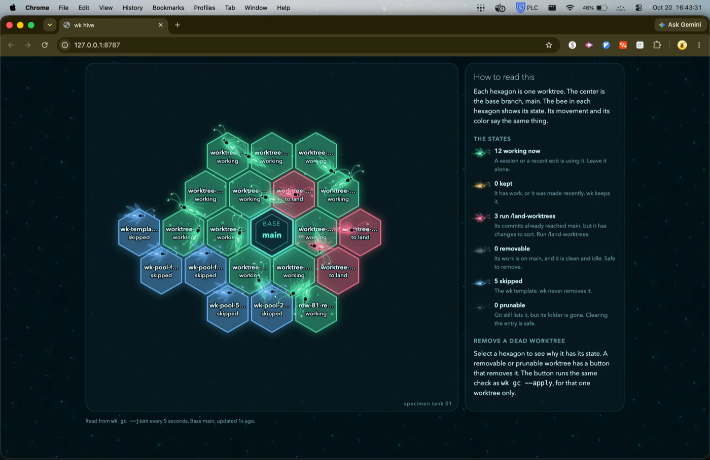
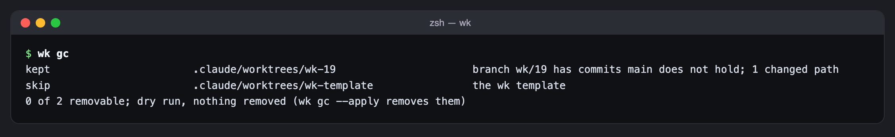

# wk

wk makes warm git workspaces for parallel agents. A workspace is a git worktree whose dependency trees, such as `node_modules`, are already in place. wk does not install them again. It copies them from a template worktree with copy-on-write clones, so a new workspace costs almost no disk and little time. wk also judges which worktrees are finished and removes them.

wk is the first phase (P1) of a planned layer over git in four phases: cheap workspaces, path leases, landing changes on the server side, and one gate run per batch. Only P1 is built. The design and the build plan live in the ezhomesteading repository, under `docs/incomplete/landing-layer/`.



The hive is the page `wk viz` serves. Each hexagon is one worktree, and the center is the base branch. The [hive section](#see-the-hive) explains each state.

What changed recently: the hive page has a plain legend and no top bar, and it can remove one dead worktree at a time. `wk setup --yes` writes a repository's config with no terminal, for an agent.

## Requirements

wk needs Go 1.24 or later to build and git to run. `wk new` needs macOS on APFS, because the copy-on-write step uses `clonefile(2)`. On any other system the clone step fails with an error that says so, since a byte copy of `node_modules` would cost the disk that wk exists to save. The `gc schedule` command writes a launchd agent, so it is macOS only as well. `wk gc` finds busy worktrees with `lsof`.

## Install

```bash
git clone https://github.com/zach-short/wk.git
cd wk
go install ./cmd/wk
```

`go install github.com/zach-short/wk/cmd/wk@latest` does the same without a checkout. The scheduled cleanup and the Claude Code hooks run the installed binary at its absolute path, so install it this way and not with `go run`, and reinstall from the branch whose hooks are installed: a binary built from an older commit has no `hook` command, and every worktree request then fails.

## Set up a repository

Run `wk` with no arguments inside a repository, in a terminal. The first time, it opens a guided setup. It reads the repository for package manifests, lockfiles, `.env` files and local branches, then asks which to use. It looks at file names only, so a `.env` file is listed and never opened. After the review step it writes the config to `~/.wk/<repo>.toml`. Two last choices are to build the template at once and, on macOS, to install the scheduled cleanup.

Setup never overwrites a config, because a config can hold hand-written notes. Once the file exists, a bare `wk` opens a home screen that shows the settings in use and offers to open the hive. Piped or run without a terminal, a bare `wk` prints the usage text.

An agent without a terminal runs `wk setup --yes` instead. It writes `~/.wk/<repo>.toml` with every choice the guided setup starts on: each clone directory, each untracked `.env` file, `.claude/settings.local.json` when present, the first install found, and a base of `main` (else `master`, else the checked-out branch). It prints the path of the file on stdout and each choice on stderr, refuses with exit 1 when the file exists, and builds no template and installs no hook or schedule. `wk setup --print` writes nothing and prints the config on stdout. Read the result back with `wk config show`.

## Make a workspace

```bash
cd "$(wk new 12)"
```

`wk new <row>` creates the workspace for row 12 and prints its absolute path on stdout. Progress and timings go to stderr, so the command substitution above captures only the path. A row is a positive integer of up to nine digits. By default it gives the directory `.claude/worktrees/wk-12` inside the main checkout and the branch `wk/12`, both cut from the base branch. The command refuses to run if that directory or branch already exists.

The shape of the checkout follows `workspace.sparse`. A sparse checkout leaves out the entries of `workspace.sparse_exclude`: a directory excludes everything under it, and an entry with a glob character, such as `docs/incomplete/**/*.png`, is a pattern, so a repository can leave out its screenshots and keep its markdown. `wk new <row> --sparse` and `wk new <row> --full` override the default.

When the pool holds a ready slot of the right shape (see below), `wk new` moves it into place, puts it on the new branch and returns. Otherwise it works from the template. Before it makes anything, it compares the template with the base branch. If the file named by `template.refresh_on` has changed since the template was built, or the template is missing, wk refreshes the template first. If only the base's commit moved, and `template.follow_base` is on, the refresh is light: a checkout, the copies and the post-clone commands, with no build. wk gives up after two refreshes, so a lockfile that changes every minute cannot hold the command forever.

Then wk adds the worktree without a checkout. It checks out the tree and clones every directory in `template.clone_dirs` at the same time, copies the files in `template.copy_files`, and runs the `template.post_clone` commands, unless the workspace sits at the template's own commit, where they would only rewrite what was cloned. At most `new.max_parallel` workspaces clone at once and the rest wait their turn: APFS runs concurrent clones and file writes on one volume one after another, so more at once only makes each of them finish late. If any step fails, the workspace stays on disk for inspection and the error says where.

## The pool

`pool.size` full and `pool.sparse_size` sparse workspaces can be made ahead under `pool.dir`, so the first agents of a burst start in under a second. A marker in each slot's private git directory records its state, its checkout shape and the template it was cloned from. A claim moves the slot to the workspace's path with `git worktree move` and attaches the branch; after every claim, a background `wk pool fill` makes a replacement, with its output in `~/.wk/<repo>/pool.log`. A slot whose template or shape no longer matches is never claimed, and the next fill removes it. `wk pool status` lists the slots. Both sizes default to 0.

## The template

The template is a detached worktree at the base branch's commit, under `template.path`. It is detached because git does not allow a second checkout of a branch that the main checkout already holds. wk writes a marker file in the template's private git directory. It will not take over a directory that is not a template, and `wk gc` never removes one.

`wk template refresh` rebuilds it by hand. A refresh moves the template to the base commit, copies the files, runs `post_clone`, then runs the `template.build` commands with the variables from `[gates.env]` set. A lock file serializes the work. `wk new` takes it shared, so many workspaces can clone at once, and a refresh takes it exclusive, so no clone reads a tree while it is being written. `wk gc --apply` takes it exclusive only for `git worktree prune`, the one step that could race a new workspace.

## The Claude Code hooks

`wk hooks install` adds four hooks to `.claude/settings.local.json` in the main checkout and in the template, and the two entries of the lease hook while leases are on (see "Path leases" below), with the permission twins of the gates the `PreToolUse` hook wraps (see "Permission twins" below). It keeps every other key in the file in its order, refuses a file that is not a JSON object, and changes nothing when the entries are already there. It never writes `~/.claude/settings.json` or a tracked settings file. `wk hooks uninstall` removes only wk's entries and twins.

- `WorktreeCreate` runs `wk hook worktree-create`. Every worktree Claude Code makes, for a session, a desktop-app worktree session or a subagent with `isolation: "worktree"`, then comes from wk, named as Claude Code names its own (`.claude/worktrees/<name>` on `worktree-<name>`) and starting from the HEAD of the session that asked. Claude Code has no fallback when this hook fails, so wk falls back to a plain `git worktree add` whenever the warm path fails, and exits non-zero only when git cannot make a worktree either. Setting `WK_HOOK_FAIL=1` in the hook's command makes the warm path fail on purpose, to prove the fallback.
- `SubagentStop` runs `wk hook subagent-stop`, which marks a stopped subagent's own worktree for `wk gc`. It marks nothing unless the worktree at the subagent's working directory is named for that subagent, and it always exits 0, because a failing stop hook would keep the subagent running.
- `WorktreeRemove` runs `wk hook worktree-remove`. Claude Code sends it only when the owner discards a worktree explicitly; wk then removes it with `--force` and keeps its branch unless the base already holds it.
- `PreToolUse`, on the `Bash` tool only, runs `wk hook pre-tool-use || true`, which routes gate commands through `wk run --slot` (see "Cap heavy gates" below). Its timeout is 5 seconds, and it goes after any other tool's `Bash` hook, such as a commit guard. A binary older than this hook prints its usage and exits 2, and exit 2 from a `PreToolUse` hook blocks the call, so the `|| true` turns an old binary into no answer and every `Bash` call runs unchanged. The guard needs Claude Code to run the command through a shell, which it does for a hook command with no `args`.

Claude Code never removes a hook-made worktree by itself, so `wk gc` is what cleans up after agents. Every call of these four is logged in `~/.wk/<repo>/hook.log`.

## Cap heavy gates

Each type check, lint or test run peaks near 1 GiB, and a web build near 2 GiB, so ten agents that start their gates together can exhaust a 16 GB machine. `wk run --slot <class>` makes them take turns. It holds one of the class's places while its command runs, and waits in arrival order while every place is held. The places are lock files under one directory, so the cap holds across every workspace and every repository on the machine.

```bash
wk run --slot heavy --trim web/.next/cache -- bun run build
wk run --slot check -- bunx tsc --noEmit
wk slots
```

`wk run` passes the command's input, output, signals and exit status through unchanged, and prints nothing when a place is free at once. When it has to wait, it prints one line as the wait starts, naming each holder, and one as the command starts. A command killed by `SIGINT`, `SIGTERM`, `SIGHUP` or `SIGKILL` makes `wk run` die of the same signal, so a shell script stops as it would have; any other signal gives 128 plus its number. A command that is not found gives 127, one that cannot be run gives 126, and a bad `wk run` argument list exits 2 with the usage text. Each `--trim` path, relative to the git top level, is removed after the command ends with any status, while the place is still held. `--keep` skips the trim, and it never runs in the main checkout, the template or a pool slot. A `wk run` inside another one (`WK_SLOT_HELD` is set) takes no place, so a build that starts a type check cannot deadlock against itself. Every slotted run appends one line to `runs.log` in the slots directory.

`wk slots` lists each class with its capacity, the holder of each place, the waiters in queue order and the last five runs, then the count and the newest line of `missed.log` and `errors.log` from the last 24 hours. `wk slots --json` prints the same as one JSON document. It reads the places without taking one.

### The hook

`wk hook pre-tool-use` sees every `Bash` call before it runs. When the command holds a gate spelling of the repository's slots file, the hook returns the command with `<wk> run --slot <class> [--trim <path>]... -- ` inserted before that gate, and changes no other byte:

```
cd web && bunx tsc --noEmit && bun run lint && bun run build
cd web && /Users/me/go/bin/wk run --slot check -- bunx tsc --noEmit && /Users/me/go/bin/wk run --slot check -- bun run lint && /Users/me/go/bin/wk run --slot heavy --trim web/.next/cache -- bun run build
```

It parses the command as bash, with `mvdan.cc/sh/v3`, and rewrites a gate in any statement position: after `&&`, `||`, `;`, `|` or `&`, and inside `( )`, `{ }`, `if`, `while`, `until`, `for` and `case`. It leaves a gate alone inside a word (`$( )`, backticks, `<( )`, the string of `bash -c`), inside a function body and after `time`, and it leaves the whole command alone when it does not parse or already holds `wk run`. Each spelling it leaves alone goes to `missed.log` with the reason, so the list of spellings can grow from evidence. A rewritten call also gets a `Bash` timeout of 600,000 ms, Claude Code's maximum, so a gate that waits for a place is not moved to the background after the default two minutes.

The hook always exits 0. It returns nothing when there is no slots file, when nothing matches, or when its own deadline (`hook.timeout_ms`) has passed, and it logs its own failures to `errors.log`. The one exception is `hook.fail_open = false` with a slots file it cannot use: it then refuses every `Bash` call with a JSON deny, still with exit 0, until the file is fixed.

### The two config files

Both files are optional. Without `~/.wk/machine.toml`, `wk run` runs every command unslotted with one line on stderr. Without `~/.wk/<repo>.slots.toml`, the hook rewrites nothing.

`~/.wk/machine.toml` holds the classes for the whole machine:

```toml
[slots]
dir = "/Users/me/.wk/slots"
order = "fifo"
max_wait_seconds = 0
min_free_mb = 0

[slots.heavy]
capacity = 1

[slots.check]
capacity = 2
```

`~/.wk/<repo>.slots.toml` holds one repository's gate spellings. It is a file of its own, and not a table in `~/.wk/<repo>.toml`, because a binary older than this feature never reads it: an unknown table in the repository's config would make that binary refuse the whole file and fail every worktree request.

```toml
[hook]
fail_open = true
timeout_ms = 200

[[slots.match]]
spelling = "bun run build"
class = "heavy"
trim_after = ["web/.next/cache"]

[[slots.match]]
spelling = "bunx tsc"
class = "check"
```

The dials, with the values ezhomesteading uses:

| Dial | File | Value | What it does |
|---|---|---|---|
| `slots.dir` | machine | `<WK_HOME>/slots`, written out as an absolute path | Where the places, the queue and the logs live |
| `slots.order` | machine | `fifo` | `fifo` admits in arrival order; `any` takes no ticket, and any waiter may take a free place |
| `slots.max_wait_seconds` | machine | 0, no limit | Above 0, a wait of that length ends with exit 75 |
| `slots.min_free_mb` | machine | 0, off | Above 0, a waiter also waits until free, inactive and speculative memory (`vm_stat`) reaches it |
| `slots.heavy.capacity` | machine | 1 | Runs of class `heavy` at once |
| `slots.check.capacity` | machine | 2 | Runs of class `check` at once |
| `slots.match`, class `heavy` | slots file | `next build`, `bun run build`, `bun run e2e`, `playwright test`, `go run ./cmd/lintgate`, `bunx next build`, `bunx playwright test` | The spellings that take a heavy place |
| `slots.match`, class `check` | slots file | `tsc`, `bunx tsc`, `eslint`, `bun run lint`, `vitest`, `bun run test`, `go test`, `bunx eslint`, `bunx vitest` | The spellings that take a check place |
| `trim_after` | slots file | `["web/.next/cache"]` on `next build`, `bun run build` and `bunx next build` only | The `--trim` paths the hook writes |
| `hook.fail_open` | slots file | `true` | `false` refuses every `Bash` call while the slots file is broken |
| `hook.timeout_ms` | slots file | 200 | The hook's own deadline; past it the hook returns nothing |

No class name or spelling is built into wk. An unknown key in either file is an error, so a typo never drops a gate in silence. A spelling may be listed once only, a class name may hold only letters, digits, `-` and `_`, and a `trim_after` path must be relative and hold no `..`.

### Fail open

A gate must never turn red or green because of wk. Every failure of the machinery therefore runs the command unslotted, with one line on stderr that starts `wk run: running unslotted:` and one line in `errors.log`: a broken machine file, an unknown class, a slots directory wk cannot write, or any error in the queue. The hook fails open the same way. An error, a panic, a slow `git` or a broken slots file with `fail_open = true` leaves the command as the agent wrote it. The `|| true` in the settings entry covers the last case, a binary that has no `pre-tool-use` verb at all.

### Permission twins

Claude Code matches its permission rules against the command the hook returns, so `Bash(bun *)` does not cover `/Users/me/go/bin/wk run --slot heavy -- bun run build`. A wrapped gate would lose its allow rule, and a deny rule would stop refusing it with no sign. So `wk hooks install` writes a wrapped twin of every `Bash` allow, ask and deny rule that covers a spelling, into the original's own list. It reads the rules from `~/.claude/settings.json`, the tracked `.claude/settings.json` of the main checkout and the file it writes, and writes twins only into that local file. `Bash(bun *)` gains one twin for each prefix the hook can put before a `bun` gate:

```
Bash(/Users/me/go/bin/wk run --slot heavy --trim web/.next/cache -- bun *)
Bash(/Users/me/go/bin/wk run --slot heavy -- bun *)
Bash(/Users/me/go/bin/wk run --slot check -- bun *)
```

A twin allows exactly what its original allows, because `wk run` runs the words after `--` and nothing else. The twins come from the files as they are at install time, so run `wk hooks install` again after you change the slots file or a permission rule: until then, a new spelling is wrapped without its twins. A twin whose original rule is gone is removed at the next install, and `wk hooks uninstall` removes every rule that starts with `Bash(<absolute path>/wk run --slot `. A settings source that is not valid JSON stops the install before the file is changed.

Two limits are known. A rule that starts with `VAR=value` words, such as `Bash(GOTOOLCHAIN=local go test *)`, gets no twin, because the hook puts its prefix after those words; no gate rule had that shape on 2026-10-16. And wk owns every rule of the twin shape in the local file. A rule in that shape that wk did not compute, written by hand or by the permission prompt's option to stop asking about a wrapped command, is removed at the next `wk hooks install` with no message. Put such a rule in `~/.claude/settings.json` or the tracked `.claude/settings.json`, which wk never writes.

### Install order

Once the `PreToolUse` hook is installed, `~/go/bin/wk` must always be built from a commit that has `wk run` and `wk hook pre-tool-use`. A binary from an older commit has neither: the `|| true` keeps every `Bash` call running, but nothing is slotted, every `Bash` call still starts one wk process, and any command that calls `wk run` itself fails with exit 2. So the order is: install the binary, write the two config files, then run `wk hooks install`, which reads the slots file to write the twins. In ezhomesteading the binary with this feature is installed by board row 214, not by the commit that adds it.

## Path leases

Two agents in two worktrees can edit the same file, and the clash shows only when the branches land. Path leases stop the second edit when it is made. Each workspace claims a board row, takes a lease on the paths in that row's "Files it owns" cell, and a `PreToolUse` hook refuses every edit to a path that another workspace leases. Leases are off until `leases.enabled = true` is in the repository's config.

### The claim

```bash
wk claim 12             # lease the paths of row 12's "Files it owns" cell
wk claim --none         # claim no path, for a session that reads and does not edit
wk lease add web/x.ts   # lease one more path; a trailing / leases a directory
wk release              # drop the claim and every lease
wk status               # every claim, its row and its leases
```

Every session runs `wk claim <row>` or `wk claim --none` in its workspace before its first edit. With leases on, the hook refuses any edit from a workspace that has not claimed. `wk claim` reads the board named by `leases.board` in the main checkout and finds the row's cell by the column header "Files it owns". Each backtick token becomes a lease: an exact path, a directory (a trailing `/`, `/**` or `/**/*`), or a glob, which is expanded against the files git tracks in the workspace. Every token it cannot read (prose, a path starting with `~` or `/`, a path with `..`, a glob that matches nothing) is printed as `unread:`, and only what it read is leased, so a cell written as prose leases nothing and says so. A claim is refused when one of its paths overlaps a lease another workspace holds, and the refusal names that workspace's row and directory. Running the same claim again succeeds and prints the claim it found. A workspace holds one claim at a time, so a second row needs `wk release` first. A lease has no time limit; it ends with `wk release`, or when its worktree is removed.

The leases live in `~/.wk/<repo>/leases.json`. Each change takes an exclusive lock on `~/.wk/<repo>/leases.lock`, rewrites the file and renames it into place, so a crash leaves the old file or the new one. Readers take no lock. The file records the repository's git directory, and wk refuses a store that belongs to another repository with the same name.

### The hook

`wk hooks install` adds two `PreToolUse` entries while `leases.enabled` is true, and removes them when it is false. Both run `wk hook lease --repo <main checkout>` with a timeout of 5 seconds.

- The first matches `Edit|Write|MultiEdit|NotebookEdit` and carries `"onFailure": "block"`, so Claude Code (2.1.295 or later) refuses the edit when the hook cannot run at all: a missing binary, a crash or a timeout.
- The second matches `Bash` and ends in `|| true`, without `onFailure`, so a missing or older binary leaves `Bash` free and the binary can always be installed again.

The hook refuses an edit, with a reason that says what to do next, when the workspace has not claimed, when another workspace leases the path, when the path is in `leases.single_writer` and this workspace does not lease it, and when the path is in another worktree of the repository than the session's own. A session whose directory is in no worktree of the repository may write into none of them. A path outside every worktree of the repository is allowed. The hook reads `leases.json` itself and runs no git. It reads each path as the kernel does: it follows every symbolic link, a dangling one included, before it applies a `..` that comes after it, and refuses a path with a link loop or a link it cannot read. So `/tmp/x` and `/private/tmp/x` are one path on macOS, and a link into another worktree is judged where it leads. Each path is also judged with its last component not followed, because `rm`, `mv`, `ln` and `git rm` act on a link itself: the parent is read through links first, with each `..` applied after the link before it, and only the last component is kept as written. For the edit tools a third spelling is judged, the path with each `..` removed by text first, as a tool that cleans its path before it writes would. In `Bash`, git cleans its pathspecs by text, so a `git rm` or `git mv` operand with a `..`, or a `git rm` operand with pathspec magic (a leading `:`), is refused; the other programs tested on 2026-10-17 (`cp`, `install`, `rsync`, `tee`, `touch`, `ln`, `dd`, `truncate`, `mv`, `tar`, `python`, `perl` and `sed`) write where the kernel resolves. Any spelling refusing refuses the call. A `cd` to a directory with a `..` is followed both ways too, to the directory a logical `cd` reaches and to the one the kernel reaches through links. On a volume that ignores letter case, as APFS does by default, the hook compares paths in lower case, so its messages name them in lower case, and it refuses a path with a non-ASCII character below the worktree, whose other Unicode spellings it cannot compare. It measured 20 ms or less over 20 runs on 2026-10-17. Each refusal is a line in `~/.wk/<repo>/hook.log`.

The guard fails closed. With leases on, a config file wk cannot read, a store wk cannot read, input it cannot parse, or a failure inside the hook refuses the edit, because an edit that passes by mistake is a silent clash, and a refusal costs one message. The hook always exits 0 and refuses by printing Claude Code's deny on standard output, so a non-zero exit never blocks a call by accident.

A worktree not made by `wk new` or by the `WorktreeCreate` hook has no `.claude/settings.local.json`, so the guard is absent in it. Add `.claude/settings.local.json` to `template.copy_files` so that `wk new` copies the hook into each workspace. A workspace keeps the settings it was made with: one made before `leases.enabled = true` has no lease hook, and one made before leases were turned off keeps it and logs an allow line for each call. After turning leases on or off, run `wk hooks install`, which writes the main checkout's and the template's file only, then copy the main checkout's `.claude/settings.local.json` into each existing workspace, or remove and make each workspace again.

### Bash coverage is partial

The `Bash` entry walks the command's words and refuses the write spellings it recognises when they reach a leased path: the `>` redirections, `rm`, `touch`, `tee`, `mv`, `cp`, `sed -i`, `git mv`, `git rm`, the git commands that rewrite the whole worktree, and more. A command it cannot read is refused whole: any `$`, backtick, parenthesis, brace, bracket, `*`, `?`, backslash or non-ASCII byte, a subshell, a shell function, a `case`, an `xargs` with a writing verb, `patch`, `find -exec`, or a shell reading standard input. A command with no write target the walk recognises is allowed without reading the store, and so is a single `wk` command with no operator or redirection, so `wk claim` is never locked out.

The walk is a list of known spellings, so a program it does not know writes unseen: `make`, `go fmt`, `go generate`, `npm install`, `curl -o`, `unzip`, `mkdir -p`, `chown`, a script run by name (`./script.sh`, `python3 f.py`), `perl -e` and `ruby -e` programs without parentheses, and wrappers outside its table such as `flock`, `watch` or `npx`. An alias or function from the shell profile is not seen either. The `Edit`, `Write`, `MultiEdit` and `NotebookEdit` entries name their file, so they have no unknown spelling; each edit is judged at the path as written and cleaned by text, and at its kernel path, as above.

The known over-refusals each cost one message. A command with `$` or a glob anywhere is refused even when it writes nothing leased; a `cd` makes a later relative target count in both directories; a whole-tree git command such as `git pull` or `git merge` is refused while any other workspace holds a lease; a write through a symbolic link that sits in a directory another workspace leases is refused, even when the write lands somewhere free; and a `git rm` or `git mv` operand with a `..`, or a `git rm` operand starting with `:`, is refused even when it names a free file.

### The ledger files

In a repository whose `leases.single_writer` lists `HANDOFF.md` and `PASSOFF.md`, the lead session writes them from the main checkout under a lease of its own: `wk claim --none` there once, then `wk lease add HANDOFF.md PASSOFF.md` before it writes. While the lead holds them, another workspace's edit to either file is refused, and the lead's `wk release` frees them. A builder in a worktree cannot write the main checkout's copy in any case, because the hook refuses an edit into another worktree than the session's own.

## Land work through the queue

In a repository with `landing.enabled = true`, an agent lands its work with `wk submit` and never runs `git commit`, `git merge` or `git push` in a workspace. The landing commits are written by wk, each with the message `row <n>: <message>` in lowercase, the author from `git config`, and no trailer.

```bash
wk submit -m "add the page"          # the working tree becomes a changeset; prints its id
wk submit -m "add the page" --row 12 # the row prefix; without --row it comes from wk claim
wk submit -m "..." --review "audit 2" # the review a repository with require_review asks for
wk sync                              # move the workspace to the landing tip, work carried across
wk land                              # the landing tip against main, and what blocks a fast-forward
wk land --apply --expect <hash>      # fast-forward main to the landing ref and push it
wk status                            # every claim, then every changeset with its state
```

`wk submit` writes the workspace's working tree as a git tree through a private index, so tracked edits, deletions and untracked files that are not ignored are in and the workspace's own index is untouched; each included path is listed on stderr first. The changeset's base is the merge base of the workspace's HEAD and the landing tip. The changeset is appended to `~/.wk/<repo>/queue.jsonl` as `submitted`, its id is the only line on stdout, and the landing worker is started. `wk submit` refuses the main checkout, which is reserved for landing.

The worker is `wk land --loop`, a process that runs to completion: it takes `~/.wk/<repo>/landing.lock`, so one worker runs at a time, and exits when no changeset is left to land. Each pass puts the landing ref (`landing.ref`, by default `refs/heads/wk/landing`) where it can land, creating it at `main` when it is missing and moving it to `main` when `main` moved ahead of it, then takes every submitted changeset in queue order: it predicts the merge of the changeset's tree onto the tip with `git merge-tree`, and on a clean result writes the commit with `commit-tree` and moves the ref with `update-ref <ref> <new> <old>`, so a ref that moved under it is refused and predicted again on the next pass. A conflict marks the changeset `refused` with the conflicting paths. Before each swap the worker appends a `landing` line with the predicted tree, and a changeset whose tree is already the tip's tree is marked `landed` without a new commit, so a worker killed between the swap and its last line never writes the same commit twice. When `main` and the landing ref each hold a commit the other does not, the worker stops and `wk status` says what to do. A landed workspace's leases are released. The worker's log is `~/.wk/<repo>/landing.log`.

`wk sync` moves the workspace's branch to the landing tip and carries its uncommitted work across; on a conflict git's markers stay in the working tree, the paths are printed, and nothing is committed. A branch that carries commits of its own is folded first: the branch is moved back to its merge base with the tip, so the commits become uncommitted work in the tree, and they stay in the branch's reflog.

Without gates, nothing moves `main` by itself: the worker lands onto the landing ref only, and `wk status` says so. `wk land` prints the landing tip, `main`, and the dirty paths in the main checkout that a fast-forward would overwrite. `wk land --apply --expect <hash>` runs the fast-forward in the main checkout while the landing ref still holds `<hash>`, refuses a stale hash and any blocker, and then pushes `main` to `landing.remote` when `landing.push` is true.

The worker also runs on a timer, so a changeset submitted while no worker could start is landed later. Save this as `~/Library/LaunchAgents/com.github.zach-short.wk.landing.<repo>.plist`, with the paths filled in, and load it with `launchctl bootstrap gui/$(id -u) <plist>`:

```xml
<?xml version="1.0" encoding="UTF-8"?>
<!DOCTYPE plist PUBLIC "-//Apple//DTD PLIST 1.0//EN" "http://www.apple.com/DTDs/PropertyList-1.0.dtd">
<plist version="1.0">
<dict>
	<key>Label</key>
	<string>com.github.zach-short.wk.landing.REPO</string>
	<key>ProgramArguments</key>
	<array>
		<string>/Users/USER/go/bin/wk</string>
		<string>--repo</string>
		<string>/Users/USER/Projects/REPO</string>
		<string>land</string>
		<string>--loop</string>
	</array>
	<key>EnvironmentVariables</key>
	<dict>
		<key>PATH</key>
		<string>/opt/homebrew/bin:/usr/local/bin:/usr/bin:/bin:/usr/sbin:/sbin</string>
	</dict>
	<key>WorkingDirectory</key>
	<string>/</string>
	<key>StartInterval</key>
	<integer>60</integer>
	<key>RunAtLoad</key>
	<false/>
	<key>ProcessType</key>
	<string>Background</string>
	<key>StandardOutPath</key>
	<string>/Users/USER/.wk/REPO/landing.log</string>
	<key>StandardErrorPath</key>
	<string>/Users/USER/.wk/REPO/landing.log</string>
</dict>
</plist>
```

## Gate each batch before it lands

With a `[[gates.run]]` list in the config, the worker gates before it lands. It takes up to `gates.batch_max` submitted changesets in queue order, once there are that many or the newest has been quiet for `gates.batch_idle_seconds`, predicts each one on top of the one before it, and runs the gates once over the final tree. On green it lands the batch in order, one compare-and-swap per changeset, then fast-forwards `main` to the landing ref when `landing.ff_main` is true and pushes it when `landing.push` is true. Each landed commit carries the tree the prediction made, and the final one is the tree the gates saw. A changeset that conflicts with the landing tip is refused as before; one that conflicts only with an earlier changeset of its batch waits for the next batch, because that earlier one may still fail.

The gates run in the trial, one workspace at `gates.trial_dir` with a detached HEAD, made by wk on first use and reused for every batch. It carries a `wk-trial` marker in its private git directory, so `wk gc` leaves it alone. For each batch the worker writes the final tree into it with `git read-tree -u --reset` and holds `~/.wk/<repo>/trial.lock` from that read to the last gate, because a build that type-checks the working tree must never see a tree half written. Each gate runs in its `dir` under the trial with `[gates.env]` added and every `gates.fresh_caches` variable pointed at a new empty directory for that run, so a cache keyed to another checkout cannot report on this tree. Before each gate the worker waits while free memory (`vm_stat`: free, inactive and speculative pages) is under `gates.min_free_mb`, and logs when it starts and stops waiting. Where `~/.wk/<repo>.slots.toml` has a spelling that matches a gate's command, the gate runs through `wk run --slot`, so the machine-wide caps of "Cap heavy gates" hold for the trial too.

A gate is `pass`, `fail` or `skip`. A gate whose `needs_env` names a variable unset in the environment the gate runs with (the worker's own, with `[gates.env]` over it) is `skip` with the reason, and a skip never counts as a pass: a run needs at least one `pass` and no `fail` to be green. A run in which every gate skipped lands nothing, and the worker stops and says why. A gate that cannot start at all, a missing binary or directory, is not blamed on any changeset; the worker stops with the error and the changesets stay submitted. A gate routed through `wk run --slot` is read the same way when `wk run` never ran its command: it exits 75 when the slot wait ran past `slots.max_wait_seconds`, and 126 or 127 when it cannot run or find the command, and in each case the gate's output is `wk run`'s own lines alone (or the line `/bin/sh` prints when the `wk` binary itself is gone). A slotted command that exits 75, 126 or 127 by itself prints output of its own, as `bun run` does for a package script that names a missing command, so it is a `fail` like any red gate: it is blamed, and the queue keeps moving. A stop for exit 75 clears by itself: the next worker, started by the timer or the next submit, gates the batch again once a slot place is free. A stop for 126 or 127 needs a person, because each worker meets the same error until the command is fixed. The landing log names a start error as one, with the gate's output, and never prints a `fail` line for it.

A gate with `timeout_seconds` (0, the default, is no limit) runs in a process group of its own, and the whole group is killed when the time runs out, children included; the gate is then a `fail` with the reason `timed out after <n>s`, blamed or bisected like any red gate. For a gate routed through `wk run --slot` the time counts from the start of the slot wait. A gate whose time ran out while `wk run` was still waiting for a place is a start error, not a `fail`: its command never ran, the time went to another workspace's run, and the next worker gates the batch again. The worker sets `WK_RUN_SAY_START` for a slotted gate, so `wk run` writes `wk run: starting <command>` just before the command starts, whether it took a place at once, after a wait, or ran the command unslotted; the command itself never sees the variable. A gate that timed out before that line is a start error, even when the line is missing because `wk run` never got as far as saying anything. After it the command ran, so a timeout is a `fail` like any other and is blamed or bisected, even when the command's own output holds a line that looks like `wk run`'s waiting line. The landing log shows the last 20 lines of the gate's output, and the failed record's reason ends with `(wk run took a <class> place after <duration>)` when the gate waited, so it says how much of the time the wait took however much the command printed. A killed `wk run` frees its place, because its places are locks the process holds.

The trial's dependencies are made once, when the trial is made. When a batch's tree changes the file `template.refresh_on` names, the worker runs the `template.post_clone` commands in the trial before the first gate, still under `trial.lock`, and records the file's new version beside the marker. When the batch changes that file, a post-clone command that fails is a red gate named `post_clone` whose path is the file, so blame finds the changeset that changed it. When the batch leaves the file as the landing tip has it, a failure (a registry that is down, say) says nothing about the batch and is a start error. Either way the next batch runs the commands again. A worker stopped while it made the trial leaves `~/.wk/<repo>/trial.making` naming it, and the next worker removes that unfinished trial with `git worktree remove --force` and makes it again. A create of the trial that fails after its directory exists leaves the record too, and its error says so after the usual "left for inspection": the next worker, which the landing timer starts within a minute, removes the directory, so copy anything needed out of it at once. A directory that someone else puts at `gates.trial_dir` in the moment between the worker's look and its create is refused with `it appeared after the worker looked, so it is not the trial`, and the record is removed, so the next worker refuses it too and never removes it. Without that record, an unmarked directory at `gates.trial_dir` is never taken over.

On red, the worker works out which changeset broke the batch. First it reads the paths the failing gate printed (`go build`, `go vet` diagnostics, including a type error after `vet: `, `gofmt -l`, `golangci-lint`, `tsc`, eslint and madge), joins the gate's `dir` onto them, and matches them against each changeset's own changes (`git diff-tree -r --name-only <base> <tree>`). That match is a first guess only, because a type check can name an innocent file that calls a symbol another changeset removed. When exactly one changeset matches, the worker gates the batch again without it, and marks it `failed` only when that run is green; the rest then land. Otherwise it bisects: the batch is split in two in queue order, the first half is gated on the landing tip as a batch of its own and lands if green, and the second half is predicted afresh on whatever landed and gated in turn; a red half is split again. A red batch of one is `failed` with the gate's name, its reason and the paths it named, which may be none. The worker never lands a tree that no green gate run saw as the final tree of its batch.

`gates.batch_max` is 1 by default: a serial gate, then land. Batching only pays when the gate is busy, that is when landings per hour times the hours one gate run takes passes 0.5. `wk status` warns when more than two batches are waiting.

```bash
wk status    # every changeset (gated, failed with the gate and the paths, landed), the last
             # gate run or the batch in flight, and why main is behind the landing ref
```

The last gate run is kept in `~/.wk/<repo>/gates.json`. A `gated` line in the queue means the batch went green and the land is in progress; a worker that stops before it lands gates that changeset again, from its submitted tree, before anything lands.

This is only cheaper if sessions stop running the gates themselves. The worker cannot see or stop a gate that a session runs in its own workspace, so with the batch gate in place a session's pass-off prompt should say: submit, and let the worker gate. Every gate a session still runs is paid twice.

## Remove finished workspaces

`wk gc` prints one line for every worktree except the main checkout, with a verdict and every reason behind it. It changes nothing. `wk gc --apply` removes the worktrees judged removable.

```bash
wk gc
```



A worktree is removable only when all of these hold: it is not locked; no process has its working directory inside it; nothing in it has changed for `gc.quiet_minutes` (60 by default); every commit on it is already in the base branch, either as an ancestor or because merging it would change nothing; and it has no changed paths. A kept worktree lists every test it failed, not only the first. The other verdicts are `kept, run /land-worktrees` for a worktree whose commits the base holds but whose tree has changes, `skip` for a template, a pool slot or a land-worktrees trial, and `prunable` for an entry whose directory is gone. The `/land-worktrees` skill is outside this repository.

Subagent worktrees, named `agent-a` and 16 hex digits as Claude Code names them, follow two other windows. One that carries the stop marker is removable when it is clean and has been quiet for `gc.stopped_quiet_minutes` (15), whether or not the base holds its commits, because its branch stays. One without the marker waits `gc.unmarked_agent_quiet_hours` (24), because a running subagent leaves no process in its worktree between tool calls.

`--apply` judges each candidate again at the moment of removal, because a session may have moved in since the pass began. It runs `git worktree remove` without `--force`, so git refuses a worktree with tracked changes or untracked files as a second guard. It deletes the branch with the worktree only when the branch is an ancestor of the base. A branch that landed by squash merge or cherry-pick is kept.

`wk gc --json` prints the same verdicts as one JSON document for other tools.

```bash
wk gc schedule install
wk gc schedule uninstall
```

`install` writes a launchd agent named `com.github.zach-short.wk.gc.<repo>` that runs `wk gc --apply` every `gc.apply_interval_minutes` (60 by default) and loads it. The log is `~/.wk/<repo>/gc.log`. `uninstall` unloads the agent and deletes its plist.

## See the hive

`wk hive` draws every worktree as a cell in the terminal, colored by verdict, and reads the verdicts again every 3 seconds. The arrow keys select a cell and `q` quits. `wk viz` serves the same view as a web page on `127.0.0.1:8787`, or on the address given with `--addr host:port`. The page reads the live verdicts on load and again every 5 seconds. The terminal view only reads. The web page can remove one dead worktree at a time, with a confirm step: a worktree that gc judges removable, or one whose folder is gone (pruned). It judges the worktree again before it acts, never forces, and answers only to requests from this machine.

```bash
wk viz
```

The hive has one hexagon per worktree, with the base branch at the center. A bee in each hexagon shows the state, and its movement and color say the same thing:

| State | Verdict | Meaning |
|---|---|---|
| working now | `kept` with a live session | A session or a recent edit is using it. Leave it alone. |
| kept | `kept` | It has work, or it was made recently. wk keeps it. |
| run /land-worktrees | `kept, run /land-worktrees` | Its commits already reached main, but it has changes to sort. Run `/land-worktrees`. |
| removable | `removable` | Its work is on main, and it is clean and idle. Safe to remove. |
| skipped | `skip` | The wk template. wk never removes it. |
| prunable | `prunable` | Git still lists it, but its folder is gone. Clearing the entry is safe. |

Select a hexagon to see why it has its state. A removable or prunable worktree has a button that removes it, or clears a pruned entry. The button runs the same check as `wk gc --apply`, for that one worktree only.

## Configuration

The config for a repository is `$WK_HOME/<repo>.toml`. `WK_HOME` defaults to `~/.wk`, and the repository is the one that holds `--repo <absolute dir>`, or the current directory. Every path in the file is relative to the main checkout and must stay inside it. wk rejects an unknown key, so a typo never silently keeps a default. A missing file is not an error: wk uses the defaults and says so on stderr.

```toml
[template]
path = ".claude/worktrees/wk-template"
refresh_on = "bun.lock"            # rebuild the template when this file changes on the base
follow_base = true                 # a light refresh when only the base's commit moved
clone_dirs = ["node_modules"]      # cloned copy-on-write into each workspace
copy_files = [".env"]              # copied into each workspace, never printed

[[template.post_clone]]
dir = "."
run = ["bun", "install", "--frozen-lockfile"]

[[template.build]]                 # runs in the template after a full refresh
dir = "."
run = ["bun", "run", "build"]

[gates]
trial_dir = ".claude/worktrees/wk-trial"  # the trial workspace; see "Gate each batch before it lands"
batch_max = 1                      # changesets per gate run
batch_idle_seconds = 120           # quiet before a batch under batch_max forms
min_free_mb = 2048                 # gating pauses while free memory is under this; 0 turns it off
fresh_caches = ["GOCACHE", "GOLANGCI_LINT_CACHE"]  # a new empty directory each per gate run

[gates.env]                        # extra environment for the build commands and the gates
CI = "1"

[[gates.run]]                      # none means no gate and no fast-forward of main
name = "vet"
dir = "backend"
run = ["go", "vet", "./..."]
needs_env = []                     # a variable named here and unset, [gates.env] included, makes the gate skip
timeout_seconds = 0                # kill the gate and its children after this long, and fail it; 0 is no limit

[workspace]
dir = ".claude/worktrees/wk-{row}"
branch = "wk/{row}"
base = "main"
sparse = false
sparse_exclude = []                # directories, or patterns such as "docs/**/*.png"

[hook]
dir = ".claude/worktrees/{name}"
branch = "worktree-{name}"

[gc]
quiet_minutes = 60
stopped_quiet_minutes = 15
unmarked_agent_quiet_hours = 24
apply_interval_minutes = 60

[new]
max_parallel = 2

[pool]
size = 0
sparse_size = 0
dir = ".claude/worktrees/wk-pool-{slot}"

[leases]
enabled = false                    # true turns the guard on; see "Path leases"
board = "PASSOFF.md"               # the board wk claim reads, in the main checkout
single_writer = []                 # paths an edit may touch only under its own lease
bash_guard = true                  # walk Bash commands for writes

[landing]
enabled = false                    # true lets wk submit and the worker run; see "Land work through the queue"
ref = "refs/heads/wk/landing"      # the ref the worker moves by compare-and-swap
remote = "origin"                  # where wk land --apply pushes main
push = true                        # push main after the fast-forward
require_review = false             # refuse to land a changeset submitted without --review
ff_main = true                     # fast-forward main after a green batch; needs [[gates.run]]
```

Both `workspace.dir` and `workspace.branch` must contain `{row}`, both `hook` paths `{name}`, and `pool.dir` `{slot}`. The values shown, except `refresh_on`, `copy_files`, the commands, `[gates.env]` and the `[[gates.run]]` entry, are the defaults. `gates.trial_dir` must be a relative path other than the main checkout itself, `gates.batch_max` at least 1, and each `[[gates.run]]` needs a `name` no other gate has, a non-empty `run`, `needs_env` entries that are variable names, and a `timeout_seconds` that is not negative. `wk config show` prints the effective config as TOML, with the file it read and whether that file was found. The `gc` windows, the interval and `new.max_parallel` must be at least 1, because a quiet window of zero could let `wk gc` remove a worktree that a session made a second ago. The `[new]` table also holds four proof thresholds that wk never enforces: `max_seconds_cold`, `max_mb_per_workspace`, `burst_size` and `burst_max_seconds`.

## Disk use

`du` counts a cloned directory at its full size, because it adds up file sizes and cannot see that APFS shares the blocks. Only `df` shows the real cost of a workspace. In ezhomesteading on 2026-10-16, a sparse workspace without the screenshots under `docs/incomplete` cost about 100 MB by `df`, a full one about 520 MB, nearly all of it git's checkout, and a worktree made before wk with its own install about 2 to 2.7 GB.

## Development

```bash
go build ./...
go test ./...
```

The tests build throwaway git repositories, stub launchd, never fork a pool fill or write a real settings file, and run their refusal cases from an empty directory, so no test touches a real repository or loads an agent into your session.

## Provenance

Several ideas come from Anthropic's article "Redesigning source control at Anthropic" (https://www.anthropic.com/engineering/redesigning-source-control). Most of them belong to the phases after P1:

- Merges happen away from the client. Here the planned daemon predicts and prepares every merge with `git merge-tree --write-tree`, and no workspace runs `git merge`.
- A reference moves by compare-and-swap, separately from creating the change. Here that is `git update-ref <ref> <new> <old>`, git's own compare-and-swap, and the tree is written long before the reference moves.
- No global repository lock. Predictions run at the same time and only the reference update is serialized; leases are per path, not per repository.
- The unit of work is a changeset in a write-ahead log, not a commit on a branch. Here it is a tree hash with a base and a message, appended to a JSONL queue, and the commit is made only when it lands.
- Sparse and optional checkouts. Here that is the sparse default and its patterns, and a single trial workspace that gates for every changeset in place of each workspace gating itself.

This tool departs from the article in one place on purpose. The article tests after the merge; this tool runs the gates before a change lands, once per batch, because a machine with 16 GB of memory cannot afford to find a red main branch afterwards and because the repository's own rule is that the gates are green before a change is done. The planned daemon then writes the landing commits itself, with a message the tool writes and no attribution line.

These ideas are local, not from the article:

- APFS directory clones (`clonefile(2)`) for `node_modules` and build caches, measured at about 4.3 s for the 96,147 files of ezhomesteading's root `node_modules`.
- The warm pool, which moves a finished workspace into place with `git worktree move`, and the stop marker that lets gc remove a finished subagent's worktree within minutes.
- Path leases seeded from a board row's "Files it owns" cell and enforced by a Claude Code `PreToolUse` hook, with an insert-only rule for the two ledger files (planned for P2).
- The owner's two commands, a dry run and an apply, inherited from the `/land-worktrees` skill, which also contributed the absorption test, the trial worktree and the four-way sort of dirty files.
