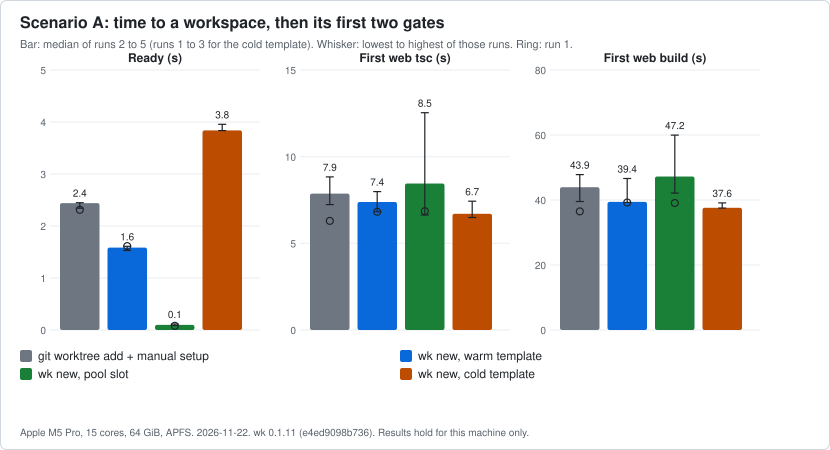
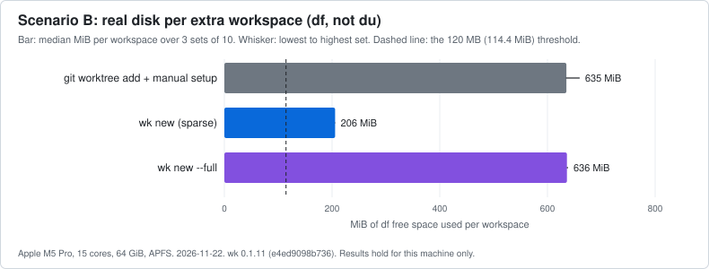
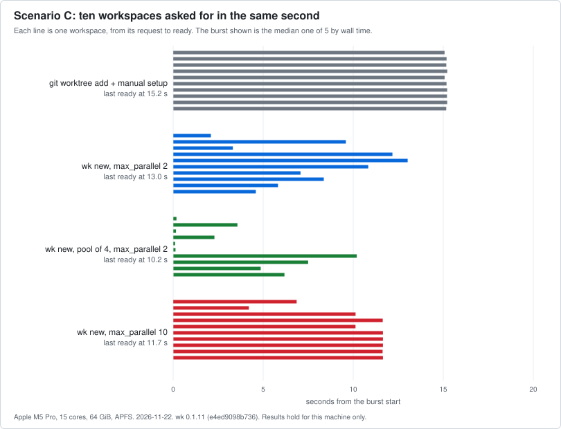
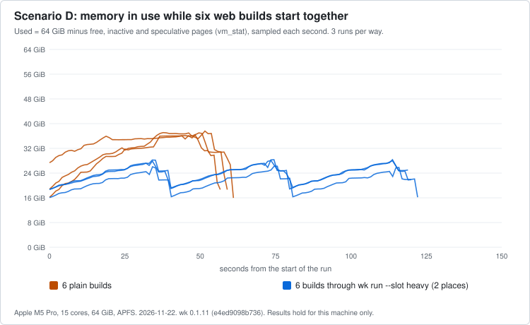
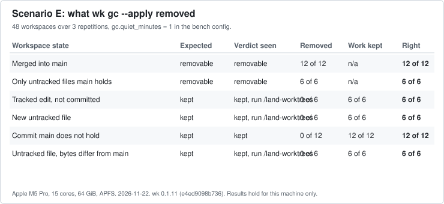

# What wk saves, measured

Board row 19. The runs took place on 2026-11-22 between 00:20 and 02:20 EST, on an Apple M5 Pro with 15 cores and 64 GiB on APFS, with wk 0.1.11 (`e4ed909`) from Homebrew. They ran against a scratch clone of ezhomesteading at `80ce82149` under a scratch `WK_HOME`. `METHOD.md` gives the method the owner approved, and `SUMMARY.md` gives every figure below. `chart.py` generates both the charts and `SUMMARY.md` from the CSVs in `data/`. The results hold for this machine only.

The machine was not idle. A Lunar Client Java process (a game client, about 9.6 GB resident) and several Claude Code sessions were running. The 1-minute load at the start of a run was between 1.83 and 4.31 (`SUMMARY.md`, "Run conditions"). Only one run started above 4 after the 5-minute wait: the first cold-template run of scenario A, which is marked `load_high` in `data/A.csv`. No run was stopped.

## Scenario A: time to a workspace, then its first gates

With plain `git worktree add` and the documented manual setup, a workspace was ready in a median of 2.44 s. With `wk new` from a warm template it took 1.58 s, and from a ready pool slot it took 0.10 s. A cold template, where `wk new` must build the template first, took 3.84 s. That is slower than the baseline, but it meets the config's `max_seconds_cold = 10`. These are the medians of runs 2 to 5 (`data/A.csv`). The spread was narrow; for the baseline it was 2.34 to 2.45 s.

That is the whole saving: about a second per workspace from the template and about two from the pool. The baseline is already fast, because on macOS bun installs with `clonefile` from its warm cache, so a plain `bun install` finishes in about 2 s.

The first gates do not get faster. The median of the first web `tsc` was 7.87 s for the baseline, 7.38 s for a template workspace and 8.45 s for a pool workspace. The median of the first web build was 43.94, 39.42 and 47.23 s, and the ranges overlap. The config clones no part of `web/.next` today and the template has no build step, so every first build in every arm is cold. The row expected a gain from a cloned build cache, and none can show with this config.

The pool arm got slower over its five runs. Its `tsc` went from 6.85 s in run 1 to 12.54 s in run 5 and its build from 39.09 s to 59.98 s, while the other arms did not slow in the same rounds. The background fill had ended before the gates started (`pool.log` shows each fill done within 2 s of its claim). I did not find the cause. It is a finding for a later row; five runs are too few to call it a trend with confidence.

## Scenario B: disk per extra workspace

By `df`, each plain worktree with its own `bun install` used a median of 635.2 MiB. A sparse `wk new` used 205.6 MiB and `wk new --full` used 636.2 MiB. Across 3 sets of 10, the spreads were under 26 MiB (`data/B.csv`). Drift in the minute before each set was at most 263.4 MiB, far below each set's own change, so no set ran again.

The whole saving is the sparse checkout. A full wk workspace costs the same as a plain worktree, because bun already shares the `node_modules` blocks with its cache, as `SLIM-SCOPE.md` predicted. The sparse rule leaves out the 447 MB of PNGs under `docs/incomplete/`. Any worktree could do that with `git sparse-checkout`; wk makes it the default. The config's `max_mb_per_workspace = 120` (114.4 MiB) is not met: a sparse workspace is 205.6 MiB, nearly all of it checked-out files.

## Scenario C: ten workspaces asked for at once

The baseline's last workspace was ready after a median of 15.23 s. For wk with an empty pool and `max_parallel = 2` it was 13.03 s, and with a pool of 4 it was 10.20 s. Every burst in every arm finished under the config's `burst_max_seconds = 60`, and none of the 200 creates failed (`data/C.csv`). Concurrent `git worktree add` calls on one repository did not collide.

The cap did not help. With `max_parallel = 10`, the last workspace was ready after 11.65 s, sooner than the 13.03 s with the default of 2, although each create took longer (a median of 11.22 s against 7.62 s) because they all ran at once. The README says that APFS runs concurrent clones one after another, so more at once only makes each finish late. On this machine at this size, the time to the last workspace shows the opposite. Whether to change the default is the owner's call; this row changes no default.

## Scenario D: six web builds at once

Six plain `bun run build` runs started together finished in 57.0 to 61.1 s. Through `wk run --slot heavy` with today's 2 places, the same six took 119.6 to 122.5 s (`data/D.csv`). No build failed either way.

The plain runs never came near the stop rule. Free memory (free, inactive and speculative pages) fell by at most 21,319 MB and never went below 27,031 MB. The lowest `memory_pressure` free figure was 83 percent. Swap grew once, from 32 MB to 318 MB during the first plain run, and then stayed at 318 MB for every later run either way. The slotted runs dropped about half as far: at most 10,393 MB.

So on a 64 GiB machine at six builds, the slot cap doubled the wall time and protected nothing that was at risk. The README's claim that gates which start together "can exhaust a 16 GB machine" was not tested, because this machine has 64 GiB and the owner capped the test at six builds. A drop of 10,495 to 21,319 MB for six builds makes the claim plausible for 16 GiB, but that is an inference, not a measurement. The owner decides whether the README shows this chart (`METHOD.md`, question 13).

## Scenario E: what gc removes

Over 3 repetitions of 16 workspaces, `wk gc --apply` gave the expected verdict for all 48 (`data/E-verdicts.csv`). It removed the 12 merged workspaces and their branches. It also removed the 6 workspaces whose only change was an untracked file byte-equal to a file committed on `main`, and deleted that file with them, by the rule of rows 31 and 32. It kept the other 30: 12 with a tracked edit or a new untracked file, 12 with a commit `main` does not hold, and 6 with an untracked file whose bytes differ from `main`. After each `--apply`, every kept edit, untracked file and unmerged commit was still in place.

gc takes time. The dry run took a median of 5.78 s and `--apply` 34.85 s, for six removals and the judgment of every other worktree. That is fine for an hourly launchd job, and slow for a command a person waits on. The bench used `gc.quiet_minutes = 1`, not the live 60, so a fresh workspace could become removable within the run.

## Scenario F: do Stop-hook gates overlap

The copied Stop-hook log has 251 gates with a `ran=` folder, from 2026-11-11 to 2026-11-22 (UTC days). 19 pairs of gates from different folders ended within 60 s of each other, and 26 gates were in such a pair (`data/F.csv`). 18 of the 19 pairs were on 2026-11-12, the one day with 167 gates. Since 2026-11-19 every gate came from one folder, so no pair was possible.

The count is an upper bound, with a limit: the log stamps only each gate's end. Two gates whose ends are 60 s apart may not overlap, and two long gates can overlap with ends further apart. On this evidence overlap is rare and came in one burst, which closes option B of `gate-contract/SCOPE.md` as the row proposed: the Stop hook stays outside `wk run`.

## Findings for later rows

- The sparse workspace misses `max_mb_per_workspace = 120` (205.6 MiB). The threshold or the sparse rule needs a decision.
- In a burst of 10 on this machine, `new.max_parallel = 2` finished the last workspace later than 10 did (13.03 s against 11.65 s).
- The slot cap of 2 heavy places doubled the wall time of six builds on 64 GiB, while free memory stayed at or above 27,031 MB.
- No build-cache gain is possible while the config clones no part of `web/.next`.
- In the pool arm of scenario A, the gates slowed over five runs for a reason not found.
- `wk gc --apply` took about 35 s for 16 workspaces.
- The README's "16 GB machine" sentence in "Cap heavy gates" was written for an older machine. This row corrects it and cites scenario D.

## What was not measured

- A cold bun cache, because no real worktree on this machine starts from one.
- A cold OS file cache, because dropping it needs `sudo purge`. Run 1 of each arm is marked, and the scenario A chart shows it as a ring.
- More than six builds, by the owner's answer to question 8, so memory exhaustion was not reached or tested.
- Heavy capacity 1, by the owner's answer to question 9.
- A cloned `web/.next/cache`, by the owner's answer to question 5.
- The true lengths of the Stop-hook gates, because the log has no start time (question 12).
- Any other machine.
